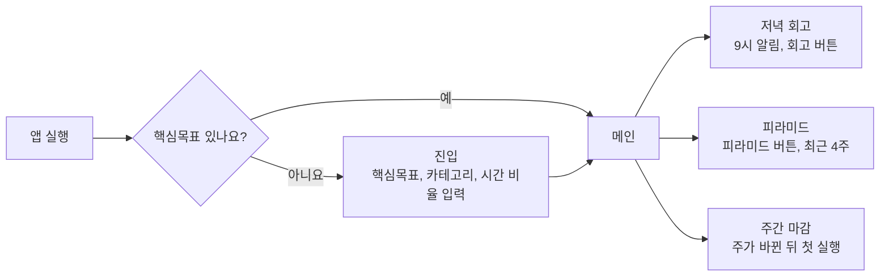

# 핵심목표 피라미드 투두 1단계 원페이저

기준일 2026-10-15 · 작성 심옹 · 첨부: 예시 화면은 Vercel 프로토타입 참고

## 무엇을 왜 만드나

1단계는 핵심목표를 위해 시간을 어디에 쓰고 싶은지 정해 두고, 저녁마다 실제로 쓴 시간을 적어 어느 쪽으로 쏠렸는지 보여 주는 투두 앱이에요. 할 일의 카테고리는 사람이 직접 골라요.

할 일 개수 대신 시간을 재요. 측정할 수 있는 시간을 남겨서 할 일을 모호하게 적지 않게 하고, 나중에 AI가 할 일을 시간 단위로 나눌 수 있도록 기록을 쌓아요. 기록한 시간은 처음에 정한 시간 비율과 비교해요.

- 핵심목표: 하나만 두는 끝나지 않는 지향점이에요. (예: 나다운 일로 먹고사는 사람)
- 카테고리: 핵심목표를 위해 시간을 쓰는 영역이에요. 최대 5개이고, 어디에도 안 맞는 일은 기타로 가요.
- 치우침: 정한 시간 비율과 실제 비율이 15% 이상 벌어진 상태예요.

## 1단계 범위

1단계에는 기록하고 치우침을 보는 데 필요한 화면 다섯 개만 넣어요. 앱이 대신 판단하는 기능은 모두 다음 단계로 미뤄요.

| 넣는 것 | 빼는 것 |
| --- | --- |
| 진입 분기, 핵심목표·카테고리·시간 비율 입력 | 앱의 카테고리 추천과 자동 분류 (2단계 이후) |
| 할 일 기록과 카테고리 직접 고르기 | AI로 피라미드 계산, 비슷한 카테고리 묶기 (검토 중) |
| 저녁 회고에서 할 일마다 시간 입력 | 타이머, 시간대별 일정, 마감 시각 |
| 피라미드 화면과 치우침 표시 | 주간 목표 완료율 |
| 주간 마감 흐름 | 목표 관련 표시 |

## 화면 흐름

앱을 열면 핵심목표가 있는지부터 확인해요. 없으면 진입 화면을 끝내야 메인으로 갈 수 있어요.

세 화면은 끝나면 메인으로 돌아와요.

매일은 메인과 저녁 회고를 오가고, 피라미드는 필요할 때 열어요. 주간 마감은 주가 바뀐 뒤 처음 열 때 한 번 떠요.

## 화면별 기능

| 화면 | 들어가는 때 | 하는 일 |
| --- | --- | --- |
| 진입 | 핵심목표가 없을 때, 건너뛸 수 없음 | 핵심목표 한 줄을 적고, 카테고리 최대 5개와 시간 비율(%)을 정해요. 비율은 똑같이 나눈 값으로 시작하고 합계가 100%여야 넘어가요. |
| 메인 | 핵심목표가 있을 때 | 위에서부터 핵심목표(제목 자리), 상단바(주 범위, 회고 버튼, 피라미드 버튼), 주간 목표 한 줄(17px), 월~일 달성 링, 일간 목록, 할 일 입력이 있어요. 할 일을 적을 때 카테고리를 고르면 할 일 옆에 라벨로 붙고, 라벨을 눌러 바꿀 수 있어요. 어제 못한 일은 그대로 둬요. |
| 저녁 회고 | 저녁 9시 알림 또는 회고 버튼 | 그날 할 일 전체에 시와 분을 숫자로 적어요. 체크 안 한 일도 쓴 시간이 있으면 적어요. 목록에 없던 일은 카테고리를 골라 바로 추가해요. 회고 한 줄은 선택이고, 이틀 전까지 채울 수 있어요. |
| 피라미드 | 피라미드 버튼 | 핵심목표, 주간 목표, 카테고리, 할 일 순서로 보여 줘요. 처음엔 최근 4주를 합쳐 보여 주고, 주를 골라 볼 수 있어요. 카테고리마다 정한 비율과 실제 비율을 나란히 두고 치우친 곳을 표시해요. |
| 주간 마감 | 주가 끝난 뒤 처음 열 때 | 1) 지난주 목표와 회고 한 줄 모음을 보고 잘된 점, 아쉬운 점을 적어요(선택). 2) 치우쳤으면 비율 조정안과 시간 옮기기안 중 하나를 골라요. 기타에 시간이 쌓였으면 새 카테고리를 만들고 옮길 할 일을 직접 골라요. 3) 이번 주 목표를 적고, 지난주 못 끝낸 일 중 고른 것만 이번 주로 복사해요. 건너뛸 수 있어요. |

## 계산 규칙

치우침은 저녁 회고에 적은 시간으로만 계산해요. 1단계에서는 아래 식을 그대로 쓰고, AI 계산은 나중 단계에서 검토해요.

| 지표 | 계산 | 보이는 곳 |
| --- | --- | --- |
| 카테고리 시간 | 그 카테고리 할 일들에 적은 시간의 합 | 피라미드 |
| 실제 시간 비율 | 카테고리 시간 ÷ 그 기간에 적은 전체 시간 | 피라미드, 주간 마감 |
| 치우침 | 실제 비율에서 정한 비율을 뺀 값이 +15% 이상이면 많음, -15% 이하면 부족 | 피라미드, 주간 마감 |
| 날짜별 달성 링 | 그날 체크한 할 일 수 ÷ 그날 적은 할 일 수 | 메인 |

- 적은 시간은 체크 여부와 상관없이 모두 들어가요.
- 기타는 정한 비율이 없어서 치우침 판정에서 빠지고, 실제 비율 계산에만 들어가요.
- 주간 마감의 비율 조정안은 정한 비율과 최근 4주 실제 비율의 중간값이에요. 시간 옮기기안은 벌어진 차이에 최근 4주 중 회고한 날 기준 주 평균 시간을 곱해 30분 단위로 보여 줘요.

## 확인할 것과 정할 것

1단계로 확인하고 싶은 질문은 치우침을 보고 다음 주에 시간을 쓰는 방식이 바뀌는가예요.

개발을 시작하기 전에 아래를 정해야 해요.

- [x] 앱 형태: 웹, Vercel 프로토타입이 이미 있음
- [x] 저장 방식: 서버와 로그인이 이미 붙어 있음
- [x] 회고를 안 한 날은 주 평균 시간에서 뺌 (비율에는 영향 없음)
- [ ] 비율을 고친 주가 섞이면 최근 4주를 어떤 비율로 비교할지
- [x] 카테고리 이름을 바꾸거나 지워도 쌓인 시간 총량은 남겨 둠. 나중에 AI로 카테고리를 묶는 기능에 씀
